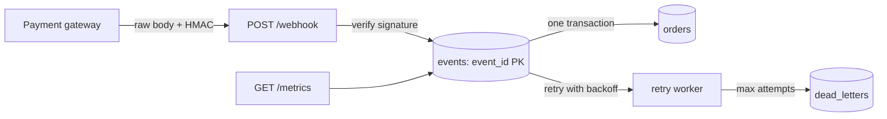

# Idempotent Payment Webhook Processor

A small FastAPI service that treats a gateway event ID as a receipt number: delivery can happen many times, but the payment effect is recorded once.

## Run

```powershell
py -3.11 -m venv .venv
.\.venv\Scripts\Activate.ps1
pip install -r requirements.txt
$env:WEBHOOK_SECRET = "development-secret"
uvicorn app.main:app --reload
```

Send a request with an HMAC-SHA256 hexadecimal digest of the **exact raw JSON bytes** in `X-Signature`.

```powershell
pytest -q
python scripts/reconcile.py gateway-events.csv --database data/webhooks.db
```

The reconciliation CSV must have `event_id,type,amount,order_id` columns. It reports events the gateway says exist but the local ledger lacks, plus field mismatches.

## Architecture



## Design decisions

- `event_id` is the SQLite primary key. The database, not an in-memory check, decides whether this is a duplicate; this works across restarts and concurrent requests.
- Signature verification happens before JSON parsing and uses raw bytes, because parsing and re-serializing could change the signed message.
- The order update and `events.status = processed` are committed in one SQLite transaction. If the server crashes before the commit, neither write survives and the event remains safe to retry; if it crashes after, both survive.
- Failures record `failed`, increment `attempts`, and schedule the next attempt at 1, 2, then 4 seconds. The third failure is copied to `dead_letters` and marked `dead_lettered`.
- The small background worker retries overdue events and also picks up `received` events left behind by a crash.

## Failure modes handled

| Situation | Result |
| --- | --- |
| Gateway sends the same event again | Unique constraint returns `already processed` |
| Invalid or missing signature | `401 Unauthorized`; nothing is stored |
| Processor fails temporarily | Records failure and retries with exponential backoff |
| Repeated failure | Keeps the evidence in `/dead-letters` |
| Crash during payment update | Transaction rolls back both order and processed marker |

## Endpoint summary

- `POST /webhook`: authenticated event ingestion.
- `GET /dead-letters`: failures needing manual attention.
- `GET /metrics`: received, duplicates skipped, processed, failed, and dead-lettered counts.
