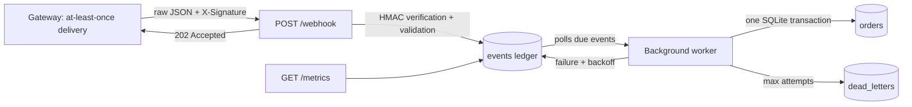
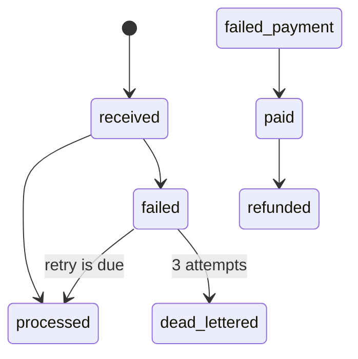

# Idempotent Payment Webhook Processor

A FastAPI portfolio project that receives payment gateway webhooks, stores every accepted event durably, and safely applies one local payment-state update despite at-least-once delivery.

## Stack

Python 3.11+, FastAPI, Uvicorn, built-in `sqlite3`, and pytest. There is no ORM, queue, broker, or external service.

## Architecture



## Webhook ingestion

1. FastAPI reads the raw body.
2. The generic HMAC-SHA256 verifier checks `X-Signature`.
3. The event is validated: IDs, type, positive integer amount, and timezone-aware `occurred_at`.
4. SQLite inserts it with `status = received`.
5. The API returns `202 Accepted` only after the insert commits.

This is like a restaurant host writing an order ticket before saying “order received.” The kitchen works separately, so the gateway does not wait for the business operation.

## Background processing and concurrency

The worker polls every second for `received` events and failed events whose `next_attempt_at` is due. For each event it starts `BEGIN IMMEDIATE`, reads the event again inside that transaction, changes the order, then marks the event processed.

`BEGIN IMMEDIATE` permits one SQLite writer at a time. If two workers select one event, one finishes first; the other gets the write lock afterwards, sees `processed`, and does nothing. SQLite is suitable for this local project, but one writer at a time limits high-volume horizontal scaling.

## Event lifecycle and states



| Gateway event | Local order state |
| --- | --- |
| `payment.captured` | `paid` |
| `payment.failed` | `failed` |
| `payment.refunded` | `refunded` |

`occurred_at` is the gateway’s event time, not HTTP arrival time. A late old event therefore cannot reverse a newer state. A different event ID that repeats an already-paid action also leaves the original local business effect unchanged.

## Database design

- `events`: receipt ledger; `event_id TEXT NOT NULL PRIMARY KEY` blocks duplicate deliveries.
- `orders`: local state and `last_event_occurred_at` for ordering.
- `dead_letters`: terminal failures with payload, attempts, error, and timestamps.
- `counters`: duplicate-delivery metric.

Existing databases migrate safely on startup. The migration preserves rows and stops if legacy rows have missing IDs rather than deleting data.

## Guarantees and limits

**Guaranteed:** duplicate deliveries with the same event ID do not repeat the local database effect; the order update and processed marker commit transactionally; received events recover after a crash; retry state survives restarts.

**Not guaranteed:** exactly-once arbitrary external side effects; unlimited horizontal scalability with SQLite; production-grade payment processing equivalent to Stripe or Razorpay.

The exact-once claim is local: the database update is all-or-nothing, like a bank transfer. If this worker also called an external email or bank API, a crash around that call could repeat it. Production systems use an outbox and downstream idempotency keys.

## Retry and dead letters

Failures persist `attempts`, `last_error`, and `next_attempt_at`. Backoff is 1, then 2, then 4 seconds. The third failure moves the event to `dead_letters`. SQLite preserves that information across restarts.

## Run and test

```powershell
cd "C:\Users\Bhavesh Bohra\OneDrive\Desktop\webhook processor"
python -m pip install -r requirements.txt
$env:WEBHOOK_SECRET = "development-secret"
python -m uvicorn app.main:app --reload
```

Open `http://127.0.0.1:8000/docs` for Swagger UI.

```powershell
python -m pytest -q
```

## Example webhook

In another PowerShell window:

```powershell
$body = '{"event_id":"evt_demo_001","type":"payment.captured","amount":500,"order_id":"order_demo_001","occurred_at":"2026-11-04T12:00:00Z"}'
$secret = "development-secret"
$hmac = [System.Security.Cryptography.HMACSHA256]::new([Text.Encoding]::UTF8.GetBytes($secret))
$signature = -join ($hmac.ComputeHash([Text.Encoding]::UTF8.GetBytes($body)) | ForEach-Object { $_.ToString("x2") })
Invoke-RestMethod -Uri "http://127.0.0.1:8000/webhook" -Method Post -ContentType "application/json" -Headers @{"X-Signature"=$signature} -Body $body
```

The immediate response is `{"status":"accepted"}`. The worker processes it shortly afterwards.

## Ten concurrent deliveries demonstration

With the server running, execute:

```powershell
python scripts/concurrent_demo.py
```

The script sends ten concurrent copies of one signed event and exits unsuccessfully unless it observes exactly 1 accepted delivery, 9 duplicate acknowledgements, and 1 newly processed event.
